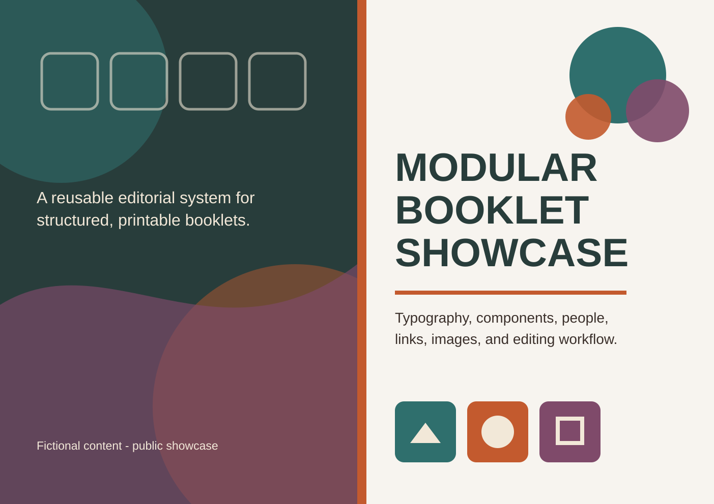

# Modular Booklet Showcase

A reusable, content-first system for producing structured A5 booklets. Authors edit TOML content and replace assets; a Python planner measures and paginates the material; Typst renders both review spreads and individual print pages.



All people, organizations, links, locations, and procedures in this showcase are fictional or illustrative.

## What it produces

- `output/pdf/Modular_Booklet_Showcase_spreads.pdf` - A4 landscape spreads for screen review.
- `output/pdf/Modular_Booklet_Showcase_A5.pdf` - separate A5 pages for printing or sharing.

The repository includes examples of chapter titles, ordinary text, bullets, highlighted statements, people cards, routing rows, QR links, shared-file links, image-and-list modules, flow images, audience markers, and two cover modes.

## Five-minute start

Requirements:

- Windows PowerShell;
- Python 3.11 or newer;
- Node.js 18 or newer;
- Arial installed locally (the font is referenced but not bundled).

Prepare the isolated project environment once:

```powershell
npm.cmd run setup
```

This creates `.venv`, installs the Python dependency inside it, and installs the Node/Typst dependencies in `node_modules`. It does not install Python packages globally.

Build and test:

```powershell
npm.cmd test
npm.cmd run build
```

PowerShell may block `npm.ps1` on managed Windows computers. Using `npm.cmd`, as shown above, avoids changing the machine execution policy.

## The normal editing workflow

1. Edit `content/book.toml`, `content/theme.toml`, or a file in `content/chapters/`.
2. Add or replace files in `assets/`.
3. Run `npm.cmd run build`.
4. Review the changed page and its immediate neighbors in the spread PDF.
5. Use the A5 PDF when individual pages are required.

For continuous preview while editing, run:

```powershell
npm.cmd run preview
```

Typst opens and watches the spread PDF. `tools/watch-planner.ps1` separately watches the TOML content and reruns the planner when necessary. `Live Preview.cmd` provides the same command as a double-clickable Windows shortcut.

## Add content

Each chapter is a TOML file containing `[chapter]` metadata followed by one or more `[[sections]]` entries. Section IDs must be unique.

### Text section

```toml
[[sections]]
id = "welcome"
type = "text"
title = "Welcome"
body = [
  "The body may contain one or more paragraphs.",
  "The planner measures them and moves the section when the remaining page space is insufficient."
]
```

### Small bullet list

```toml
[[sections]]
id = "first-week"
type = "bullets"
title = "Your first week"
body = ["A short introduction can appear before the list."]
items = [
  "Meet the team",
  "Request the systems you need",
  "Review the local working agreements"
]
```

Bullet spacing accounts for wrapped lines rather than assigning every item an identical fixed height.

### Group related sections

Use `relationship` to describe the visual connection to the preceding section:

```toml
[[sections]]
id = "support-link"
type = "qr"
title = "Further information"
relationship = "attached"
body = ["This QR belongs directly to the explanation above it."]
image = "assets/example-qr.png"
caption = "Open the resource"
link = "https://example.com"
layout = "side"
```

Relationships are features of this project, not Typst keywords:

| Value | Intended relationship | Default gap |
| --- | --- | ---: |
| `standard` | Normal transition; used when omitted | 5 mm |
| `attached` | Two parts of one visual unit | 0 mm |
| `continuation` | Direct continuation of the preceding thought | 0 mm |
| `related` | Closely related, but distinct | 2 mm |
| `relaxed` | A stronger topic change | 6 mm |
| `spacious` | Strongest supported separation | 7 mm |

The values are deterministic. The planner does not continuously optimize a gap between minimum and maximum values. Use `before_mm` only for a genuinely exceptional one-off composition.

### Person card

```toml
[[sections]]
id = "team"
type = "people"
title = "Meet the team"

[[sections.people]]
first_name = "Alex"
last_name = "Example"
room = "Project coordinator"
photo = "assets/people/alex.png"
```

Cards alternate between the inner and outer page edge automatically.

More examples and every supported field are documented in [Content and formatting reference](docs/CONTENT_REFERENCE.md).

## Change the design

The most useful global controls live in `content/theme.toml`:

| Area | Examples |
| --- | --- |
| `[colors]` | text, rules, links, and chapter accents |
| `[typography]` | body, title, and subtitle fonts, sizes, and line heights |
| `[spacing]` | paragraph, title, list, caption, and component spacing |
| `[adaptive_layout]` | semantic relationship gaps and marked-component offsets |
| `[geometry]` | page capacity, margins, and content area |
| `[images]` | standard portrait, QR, icon, and marker sizes |
| `[bullets]` | bullet diameter, text offset, and row rhythm |
| `[people]` | portrait border, corner radius, rules, and card spacing |

Prefer changing a global rule when several pages need the same correction. Prefer a semantic relationship when the distinction is meaningful. Use a numerical section-level override only when the exception is unique.

### Covers

`content/book.toml` supports:

- `mode = "image"` - place a supplied spread image as-is. Text embedded in the image must be edited in that asset.
- `mode = "generated"` - generate the cover from the configured acronym, group name, institute, tagline, note, and colors.

SVG is useful for diagrams, icons, and scalable artwork. PNG or JPEG is appropriate for photographs. Portraits should be square and should fill their crop without built-in white margins.

## Why the project has a planner

Typst is responsible for drawing and typography. `planner.py` is responsible for content-aware decisions that need to remain predictable across many editable chapter files:

1. load and validate TOML;
2. estimate wrapped text and component heights;
3. convert sections into renderable blocks;
4. keep related blocks together where requested;
5. distribute blocks across logical A5 pages;
6. insert intentional blank pages for right-hand chapter openings;
7. create the contents entries and A4 spread pairs;
8. write `generated/book.json` for Typst.

The measurement model is deliberately deterministic rather than a continuous layout optimizer. Its assumptions and extension points are described in [Planner architecture](docs/PLANNER.md).

## Project structure

| Path | Purpose | Commit it? |
| --- | --- | --- |
| `assets/` | Images, icons, and diagrams used by the booklet | Yes |
| `content/` | Book metadata, theme values, and editable chapters | Yes |
| `src/` | This project's Typst rendering components | Yes |
| `tools/` | PDF splitting and the live-preview content watcher | Yes |
| `tests/` | Regression tests for pagination and semantic spacing | Yes |
| `planner.py` | Validation, measurement, and pagination | Yes |
| `main.typ` | Typst entry point | Yes |
| `package.json` | Commands and the Typst CLI dependency declaration | Yes |
| `package-lock.json` | Exact Node dependency versions for reproducible installs | Yes |
| `requirements.txt` | Python dependencies installed into `.venv` | Yes |
| `.venv/` | Local isolated Python environment | No; generated by setup |
| `node_modules/` | Downloaded third-party Node packages, including Typst | No; generated by setup |
| `generated/` | Planner output consumed by Typst | No; regenerated by builds |
| `tmp/`, `__pycache__/` | Temporary review files and Python caches | No |
| `output/pdf/` | Ready-made showcase PDFs | Optional |

`src/` belongs to this project. `node_modules/` does not: it is generated dependency content and must not be committed.

The small test suite is worth keeping because it catches spacing, validation, and page-capacity regressions that are difficult to recognize through code review alone.

## Commands

| Command | Purpose |
| --- | --- |
| `npm.cmd run setup` | Create/update the isolated dependencies |
| `npm.cmd test` | Run planner regression tests without creating PDFs |
| `npm.cmd run build` | Build the spread PDF and separated A5 PDF |
| `npm.cmd run preview` | Watch content and layout files while editing |

`BOOKLET_PYTHON` is an advanced setup-only override for selecting which Python executable creates `.venv`. Builds and tests always use the resulting project environment:

```powershell
$env:BOOKLET_PYTHON = "C:\Path\To\Python\python.exe"
npm.cmd run setup
```

## Troubleshooting

### `npm.ps1 cannot be loaded`

Use `npm.cmd` instead of `npm`; no machine-wide execution-policy change is required.

### `Project virtual environment not found`

Run `npm.cmd run setup` once from the project root.

### A5 export reports that `pypdf` is missing

Do not install it globally. Run `npm.cmd run setup`, then rebuild. The package belongs inside `.venv`.

### The PDF builds but an edited page looks unbalanced

Check the section relationship first. Then review the changed page and its neighbors. Adjust a global theme rule before introducing a one-off `before_mm` override.

## Sample-data and publishing notes

- The supplied people and organizations are fictional.
- Demonstration links use `example.com`.
- Replace sample QR codes and links before adapting the project for real operational use.
- Keep private content in a separate, untracked content layer.
- Verify that replacement images and fonts are licensed for the intended publication.
- See [Asset provenance](ASSETS.md) for the supplied showcase files and font note.

## License

The software is available under the [MIT License](LICENSE). Documentation, written showcase content, and visual assets are available under [CC BY 4.0](LICENSE-ASSETS.md).

Suggested attribution for the documentation and assets:

> Modular Booklet Showcase by Daniel Monteiro Cunha, licensed under CC BY 4.0. Changes were made.
